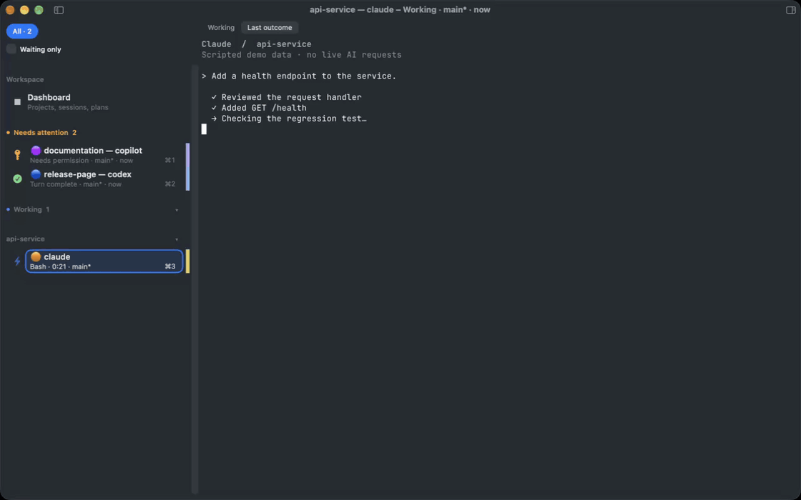

# Agent Mux

Manage Claude Code, GitHub Copilot CLI, and OpenAI Codex sessions from one
terminal dashboard or the macOS workspace. Agents run on a private tmux
server and keep running when you close the terminal or app. The macOS app
embeds Ghostty for its terminal views.

Agent Mux groups sessions by project and profile, shows which agents need you,
searches past conversations and plans, and supports resume, fork, handoff,
and managed Git worktrees. It can also start and supervise prepared
`agent-session-loop` plans.



The real macOS workspace with scripted demo data. Follow a working session’s
live tool and timer, watch it move to Needs attention, clear two prompts through
the answer queue, catch up in Briefing, and review checkout changes.
[Watch the full-resolution video](docs/media/desktop-demo.mp4) ·
[Record the desktop demo](scripts/demo/README.md#desktop-recording-on-a-physical-mac)

## First session

### macOS app

Requires macOS 14+ and an installed, authenticated Claude Code, Codex, or
Copilot CLI. The app includes `amx`, tmux, and the terminal engine; Go, Xcode,
Homebrew, and a separate `amx` installation are not required.
Checkout review and worktree actions additionally need Git.

1. Open [Releases](https://github.com/sglavoie/agentmux/releases) and
   download `Agent-Mux-<version>-macos-<arch>.zip` for your Mac: `arm64` for
   Apple silicon, `amd64` for Intel. Only architectures listed in that release
   are available. If no compatible download is listed, use the source
   installation below.
2. Expand the ZIP, move **Agent Mux.app** to **Applications**, and open it.
3. Choose **Set up first project…**, select the detected agent and project
   folder, review the checked hook-sync option, and click **Set up**.
4. Choose **Start Daemon** if offered, then **Launch project…**. Your agent opens
   in the workspace; the sidebar shows when it needs you.

Setup does not check authentication or launch an agent. **Set up manually…**
offers custom profile homes and other choices. See the
[installation guide](docs/companion-app/install.md) for setup details and recovery.

With no live sessions, the workspace offers up to five configured projects and
three recent conversations as one-click launch and resume buttons. Return opens
the full **Launch project…** menu.

Close and reopen the app to return to your running sessions. For a conversation
whose agent has ended, open **Conversation History** (`⌘Y`) and choose
**Resume**. To update, quit the app, replace it in Applications with the new
download, and reopen it; agents keep running on the private session server.
See the [app guide](docs/companion-app.md) for details and troubleshooting.

### Terminal or source installation

Requires Go 1.26.2+ (see [`go.mod`](go.mod)), [just](https://github.com/casey/just), tmux 3.5+ on `PATH`
(the optional macOS app bundles its own), and an installed, authenticated agent
CLI. On macOS, native notifications additionally need
[alerter](https://github.com/vjeantet/alerter) 26.x+ when enabled.

1. **Install from source.** Clone the repository, then run `just install`:

   ```sh
   git clone https://github.com/sglavoie/agentmux.git
   cd agentmux
   just install
   ```

   It puts `amx` in
   `~/.local/bin` (put that on your `PATH`) and creates a starter
   `~/.config/agent-mux/config.toml` if none exists.
2. **Configure.** Run `amx config setup`. It defaults to the only detected
   agent CLI and offers recent existing project directories as numbered choices.
   It asks for the profile home and a default backend, adds
   the first project without touching other settings, and offers to sync the
   profile's hooks (answer explicitly; **no** prints the command to finish
   later). Choose **Keep** to use the tmux default or **tmux** to pin it explicitly.
   For a read-only preview, use `amx config setup --detect --json`. To skip
   prompts, give both `--harness` and `--directory`:

   ```sh
   amx config setup --harness codex --directory ~/projects/my-app --json
   ```

   Optional flags are `--home`, `--title`, `--profile-name`, `--backend keep|tmux`,
   and `--sync-hooks` (off by default without prompts). See
   [setup details and JSON results](docs/operations.md#first-project-setup).
   Authentication is not checked. To write
   the configuration by hand, see [Manual configuration](#manual-configuration).
3. **Check.**

   ```sh
   amx config validate
   amx config hooks-sync        # skip if setup synced the profile
   amx backend status --check
   ```

   `amx backend status --check` exits 1 when launching on tmux would not work:
   no usable tmux or a configuration that does not load, and a private server
   that does not answer. The report names each problem and its fix.
   `amx doctor --strict` checks the whole installation.
4. **Launch.** Run `amx`, press `l`, highlight your project, and press
   `Enter`. The launcher shows the destination and effective profile. `Enter`
   on the live session attaches and `F12` detaches back to the dashboard;
   attached, `F1` shows the shortcuts and `F2` opens the live overview.

CLI launches and terminal dashboards use tmux. The macOS app shows those
sessions in embedded Ghostty terminals. See
[launch destinations](docs/usage/launching.md#launch-destinations).

### Manual configuration

Run `amx config edit` and start from this minimal Claude configuration,
replacing the project path with an existing checkout. It uses your usual Claude
home.

```toml
[defaults]
launch_backend = "tmux"

[harness_emojis]
claude = "🦊"

[[profiles]]
name = "claude-local"
harness = "claude"
home_dir = "~/.claude"
color = "yellow"

[[projects]]
title = "My project"
directory = "~/projects/my-project"
profile = "claude-local"
```

For Codex, Copilot, or an isolated profile home, follow
[Profile setup](docs/operations.md#harness-profiles); a new isolated home needs
its own authentication. The starter file documents optional settings; add them
as needed without duplicating TOML table headers. Then continue from step 3.

## Everyday use

| Task | Entry point |
| --- | --- |
| Find sessions needing input | Dashboard, or `F4` while attached |
| Answer several waiting agents | **Answer…** in the workspace header or Waiting inspector; read the prompt, choose a numbered option, and continue to the next waiting agent |
| Catch up on waiting sessions, activity, and conversations | **View → Briefing…** (⌘⇧U) or **Open Briefing** in the welcome-back card; scan one collapsed summary per session and expand **Show events** for details |
| Explore statistics and milestones | **Flight Log…** in the app's View menu, **Show Flight Log** in the dashboard command palette, or `amx session flight-log` |
| See every live pane | `F2` or `amx overview` |
| Resume or fork a conversation | `s` for project history, `S` for all history; straight there with `ctrl+shift+y`, native Conversation History with `⌘Y` in the app, or `amx past-sessions` |
| Follow work across agents | **Continued from/in** in History and the Session inspector, thread groups in Briefing, or `amx session thread <harness>:<id>` |
| Continue work with a different agent | **Continue with another agent…** in the app’s Session menu, History, or Briefing |
| Remember where a conversation left off | Automatic [conversation recaps](docs/conversation-recaps.md) in the app's Session inspector and History, or `amx session recap <harness>:<id>` |
| Read an action failure | `:` → **Show Action Feedback**; notices remain until dismissed |
| Work with plans and worktrees | `:` → **Search Plans** or **Manage Worktrees** |
| Check installation health | `amx doctor --strict` |

See [Usage](docs/usage.md) for navigation, filtering, continuity, worktrees,
and CLI examples.
See [Flight Log](docs/flight-log.md) for project missions, collectible mission
patches, scorecards, the activity calendar, weekly recaps, and local history controls.

## macOS workspace (optional)

Use the [downloaded app](#macos-app), or build it from source with macOS 14+
and Xcode after installing `amx`:

```sh
just mac-install
```

Agent Mux.app shows sessions in a native workspace with embedded terminals,
conversation history, checkout changes, and run controls. Closing the app
leaves agents running. Settings controls the answer queue (Workspace), agent
sounds (General), and matching window chrome to the terminal theme (Appearance).
All three start enabled; review windows and answer panels follow the terminal's
light or dark appearance too. Waiting and completed sidebar rows add a short
story line. Attention and completion use distinct bundled sounds, and a newly
earned Flight Log milestone can appear in the **All caught up** receipt. The
welcome-back card is optional. See
[the companion guide](docs/companion-app.md) for setup and [macOS build instructions](macos/README.md) for development.

## Maintenance and reference

- [Updates, paired ASL installation, and profile setup](docs/operations.md)
- [Troubleshooting](docs/troubleshooting.md) and [daemon diagnostics](docs/daemon.md)
- [Harness hooks](docs/hooks.md) and [watchdog state](docs/watchdog.md)
- [ASL integration](docs/asl-integration.md) and [paired releases](docs/paired-releases.md)
- [Build and test](docs/testing.md)
- [Screen classifier health](docs/screen-classifier-health.md)

`just uninstall` stops the daemon and removes the binary; configuration and
session data remain. `just mac-uninstall` removes the app and leaves agents
running unless explicitly asked to end them.

## Contributing

See [CONTRIBUTING.md](CONTRIBUTING.md) for development setup, checks, and pull
requests. Report bugs and propose improvements through
[GitHub issues](https://github.com/sglavoie/agentmux/issues). For suspected
vulnerabilities, follow [SECURITY.md](SECURITY.md).

## License

Agent Mux is licensed under the [MIT License](LICENSE). Third-party components
retain their own licenses; see the [Ghostty notice](macos/NOTICE-ghostty) and
the license files included with the bundled tmux runtime.
