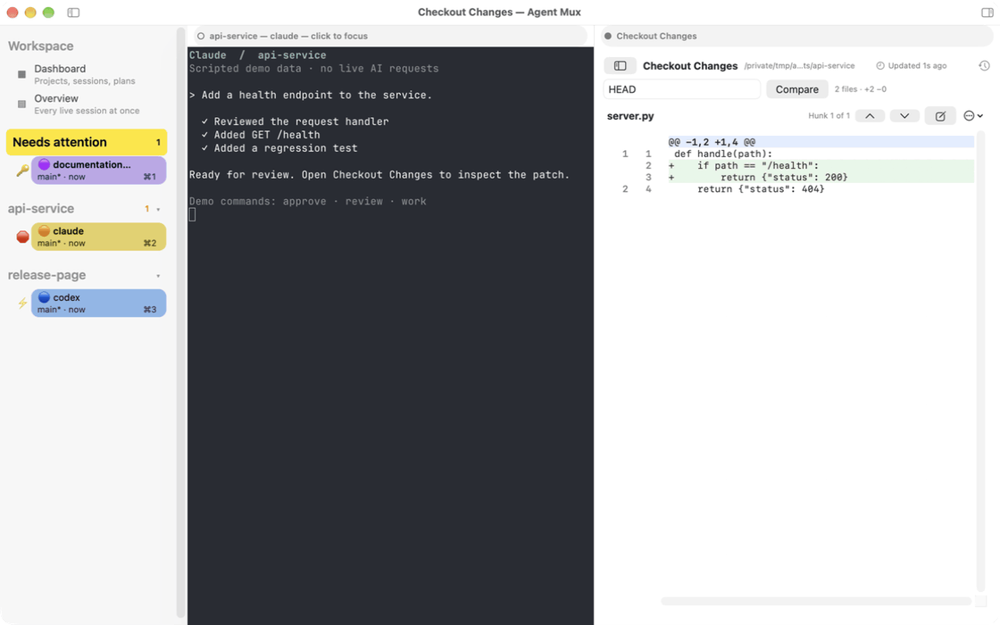

# Agent Mux

Manage Claude Code, GitHub Copilot CLI, and OpenAI Codex sessions from one
terminal dashboard or the macOS workspace. Agents run on a private tmux
server and keep running when you close the terminal or app. Kitty is an
optional backend.

Agent Mux groups sessions by project and profile, shows which agents need you,
searches past conversations and plans, and supports resume, fork, handoff,
and managed Git worktrees. It can also start and supervise prepared
`agent-session-loop` plans.



The real macOS workspace with scripted demo data. Review checkout changes
beside an embedded terminal, handle approvals in context, and navigate with
the native session switcher, inspector, and command palette.
[Watch the full-resolution video](docs/media/desktop-demo.mp4) ·
[Record the desktop demo](scripts/demo/README.md#desktop-recording-on-a-physical-mac)

## First session

### macOS app

Requires macOS 14+ and an installed, authenticated Claude Code, Codex, or
Copilot CLI. The app includes `amx`, tmux, and the terminal engine; Go, Xcode,
Homebrew, and a separate `amx` installation are not required.
Checkout review and worktree actions additionally need Git.

1. Open [Releases](https://github.com/sglavoie/agentmux/releases) and
   download `Agent-Mux-<version>-macos-<arch>.zip` for your Mac: `arm64` for
   Apple silicon, `amd64` for Intel. Only architectures listed in that release
   are available. If no compatible download is listed, use the source
   installation below.
2. Expand the ZIP, move **Agent Mux.app** to **Applications**, and open it.
3. On a fresh installation the workspace opens with **Set Up First Project**.
   Choose your agent CLI, its existing authenticated profile home, and an
   existing project directory. Choose **Keep** for the tmux default and
   explicitly answer **yes** to sync this profile's hooks. Setup does not
   authenticate the agent CLI.
4. Press **Enter** to return to the workspace, choose **Start Daemon** if
   offered, then **Launch Project** and select your project. The agent opens
   in the embedded terminal; the sidebar shows when it needs you.

Close and reopen the app to return to your running sessions. For a conversation
whose agent has ended, open **Conversation History** (`⌘Y`) and choose
**Resume**. To update, quit the app, replace it in Applications with the new
download, and reopen it; agents keep running on the private session server.
See the [app guide](docs/companion-app.md) for details and troubleshooting.

### Terminal or source installation

Requires Go 1.26.2+ (see [`go.mod`](go.mod)), [just](https://github.com/casey/just), tmux 3.5+ on `PATH`
(the optional macOS app bundles its own), and an installed, authenticated agent
CLI. On macOS, native notifications additionally need
[alerter](https://github.com/vjeantet/alerter) 26.x+ when enabled.

1. **Install from source.** Clone the repository, then run `just install`:

   ```sh
   git clone https://github.com/sglavoie/agentmux.git
   cd agentmux
   just install
   ```

   It puts `amx` in
   `~/.local/bin` (put that on your `PATH`) and creates a starter
   `~/.config/agent-mux/config.toml` if none exists.
2. **Configure.** Run `amx config setup`. It asks for the agent CLI, its
   profile home, an existing project directory, and a default backend, adds
   the first project without touching other settings, and offers to sync the
   profile's hooks (answer explicitly; **no** prints the command to finish
   later). Choose **Keep** to use the tmux default, **tmux** to pin it explicitly,
   or **kitty** to launch in Kitty tabs. Authentication is not checked. To write
   the configuration by hand, see [Manual configuration](#manual-configuration).
3. **Check.**

   ```sh
   amx config validate
   amx config hooks-sync        # skip if setup synced the profile
   amx backend status --check
   ```

   `amx backend status --check` exits 1 when launching on tmux would not work:
   no usable tmux or a configuration that does not load, whatever
   `launch_backend` says, and a private server that does not answer when
   launches go to tmux. The report names each problem and its fix.
   `amx doctor --strict` checks the whole installation.
4. **Launch.** Run `amx`, press `l`, highlight your project, and press
   `Enter`. The launcher shows the destination and effective profile. `Enter`
   on the live session attaches and `F12` detaches back to the dashboard;
   attached, `F1` shows the shortcuts and `F2` opens the live overview.

CLI launches and terminal dashboards use `--backend`, then
`[defaults] launch_backend`, then tmux. The app defaults to Workspace (tmux)
and also offers Kitty or Follow CLI configuration. Existing sessions stay on
their recorded backend. See [launch destinations](docs/usage.md#launch-destinations)
for precedence and explicit Kitty launches.

### Manual configuration

Run `amx config edit` and start from this minimal Claude configuration,
replacing the project path with an existing checkout. It uses your usual Claude
home.

```toml
[defaults]
launch_backend = "tmux"

[harness_emojis]
claude = "🦊"

[[profiles]]
name = "claude-local"
harness = "claude"
home_dir = "~/.claude"
color = "yellow"

[[projects]]
title = "My project"
directory = "~/projects/my-project"
profile = "claude-local"
```

For Codex, Copilot, or an isolated profile home, follow
[Profile setup](docs/operations.md#harness-profiles); a new isolated home needs
its own authentication. The starter file documents optional settings; add them
as needed without duplicating TOML table headers. Then continue from step 3.

## Everyday use

| Task | Entry point |
| --- | --- |
| Find sessions needing input | Dashboard, or `F4` while attached |
| See every live pane | `F2` or `amx overview` |
| Resume or fork a conversation | `s` for project history, `S` for all history; straight there with `ctrl+shift+y`, native Conversation History with `⌘Y` in the app, or `amx past-sessions` |
| Read an action failure | `:` → **Show Action Feedback**; notices remain until dismissed |
| Work with plans and worktrees | `:` → **Search Plans** or **Manage Worktrees** |
| Check installation health | `amx doctor --strict` |

See [Usage](docs/usage.md) for navigation, filtering, continuity, worktrees,
and CLI examples.

## macOS workspace (optional)

Use the [downloaded app](#macos-app), or build it from source with macOS 14+
and Xcode after installing `amx`:

```sh
just mac-install
```

Agent Mux.app shows sessions in a native workspace with embedded terminals,
conversation history, checkout changes, and run controls. Closing the app
leaves agents running. See [the companion guide](docs/companion-app.md) for
setup and [macOS build instructions](macos/README.md) for development.

## Kitty (optional)

Use `just install-kitty` and follow [Kitty setup](docs/operations.md#kitty-optional).
Its bindings include `F2` for the live session overview and
`F4` for the next attention tab. Reload Kitty after changing bindings.

## Maintenance and reference

- [Updates, paired ASL installation, and profile setup](docs/operations.md)
- [Troubleshooting](docs/troubleshooting.md) and [daemon diagnostics](docs/daemon.md)
- [Harness hooks](docs/hooks.md) and [watchdog state](docs/watchdog.md)
- [ASL integration](docs/asl-integration.md) and [paired releases](docs/paired-releases.md)
- [Build and test](docs/testing.md)
- [Screen classifier health](docs/screen-classifier-health.md)

`just uninstall` stops the daemon and removes the binary; configuration and
session data remain. `just mac-uninstall` removes the app and leaves agents
running unless explicitly asked to end them.

## Contributing

See [CONTRIBUTING.md](CONTRIBUTING.md) for development setup, checks, and pull
requests. Report bugs and propose improvements through
[GitHub issues](https://github.com/sglavoie/agentmux/issues). For suspected
vulnerabilities, follow [SECURITY.md](SECURITY.md).

## License

Agent Mux is licensed under the [MIT License](LICENSE). Third-party components
retain their own licenses; see the [Ghostty notice](macos/NOTICE-ghostty) and
the license files included with the bundled tmux runtime.
